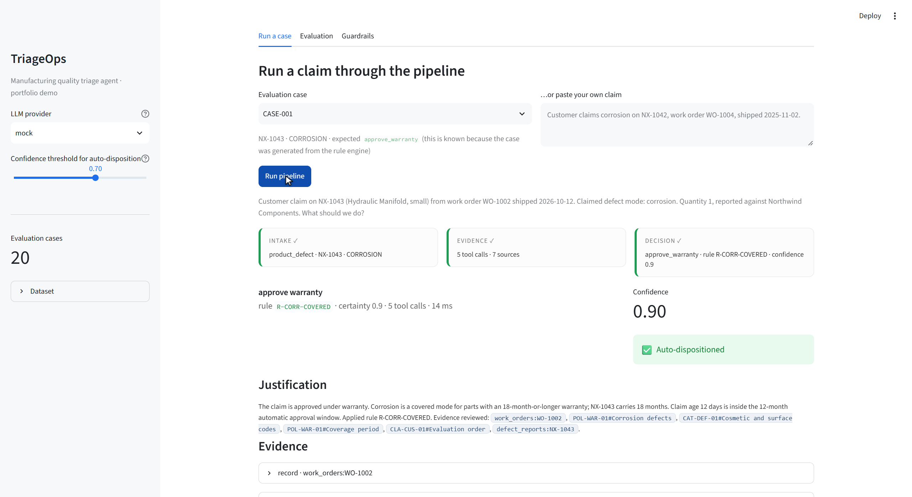
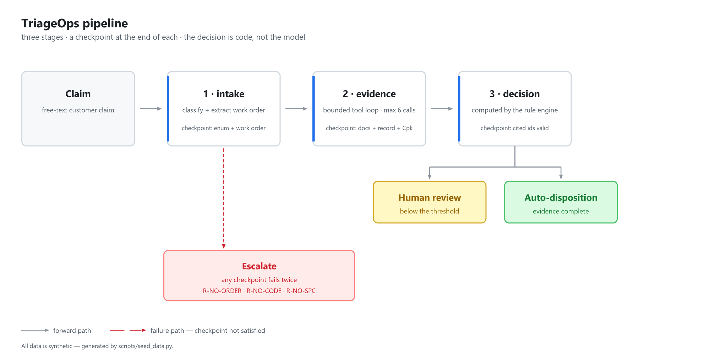
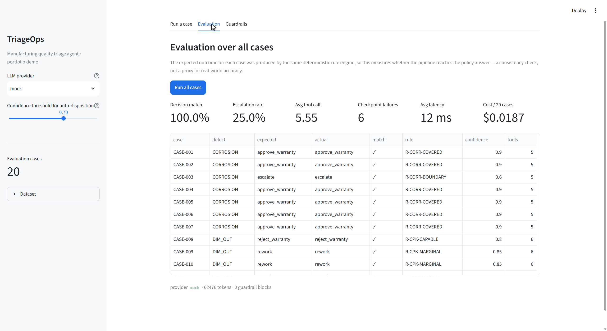
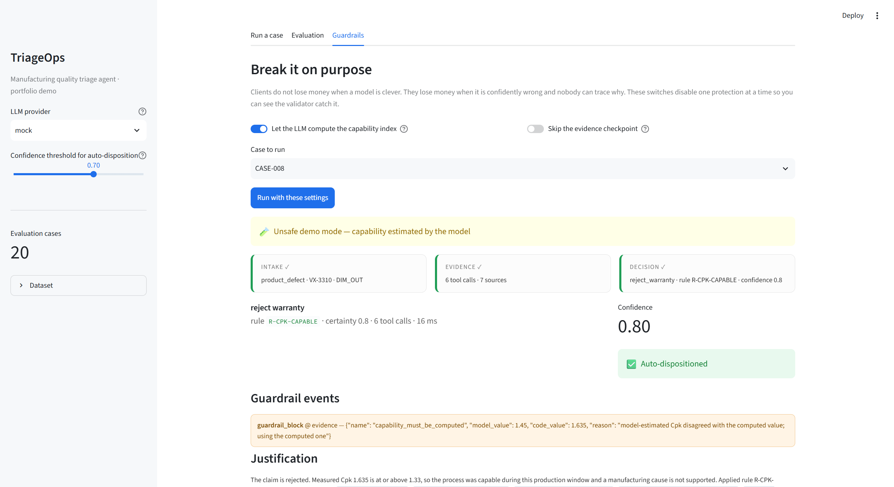

# TriageOps — a staged-checkpoint agent for operations teams

> **All data in this repository is synthetic and generated by `scripts/seed_data.py`.
> This is a portfolio demo, not a production system.**

An agent that triages manufacturing quality claims: warranty coverage, defect disposition,
supplier escalation. It is built to demonstrate the part of an AI system that clients actually
argue about later — **what happens when the evidence is missing or the model is wrong.**

Most agent demos show a model being clever. This one shows a pipeline that refuses to guess.

**Want this built for your own documents?** [Fixed-price services on Upwork →](https://xushaoheng3109.xyz/)



---

## What it does

A claim arrives as free text ("Corrosion on NX-1042, work order WO-1004, shipped 2025-11-02").
The agent:

1. **intake** — classifies the case and extracts the work order and defect code. *Checkpoint: the
   category must be a known enum and a work order must be identifiable, otherwise escalate.*
2. **evidence** — a bounded tool loop (max 6 calls). It searches the procedure documents, reads the
   production record, pulls the defect history, and computes the process capability index.
   *Checkpoint: at least one document source and one production record; measurement-dependent defect
   codes additionally require a capability record. One retry, then escalate.*
3. **decision** — the decision is **computed by rule code**, never by the model. The model only
   writes the justification, and every `[evidence-id]` it cites is validated against the evidence
   set. Confidence below the threshold routes to a human.



The diagram is generated by `scripts/make_diagram.py` and shipped as a PNG rather than a mermaid
block on purpose: mermaid only renders client-side, so on mobile apps and in PDF exports the diagram
would otherwise degrade into raw syntax.

## Why it is built this way

| Decision | Reasoning |
|---|---|
| **Staged checkpoints instead of free-form ReAct** | A ReAct loop has no definition of "enough evidence". On the same 20 cases, free-form tool selection produced paths that were correct but not repeatable. Staging makes the stopping condition explicit and auditable. |
| **The decision is code, the explanation is the model** | Warranty coverage is arithmetic and policy. A model that "decides" cannot be regression-tested, and a wrong decision is indistinguishable from a right one in the transcript. |
| **Capability is computed in Python** | `spc_metrics` returns a number produced by arithmetic. A plausible-looking Cpk generated by a model is worse than no Cpk, because it looks authoritative. |
| **Citations are validated after generation** | Prompt instructions reduce invented citations; they do not eliminate them. A post-check that rejects unknown ids is deterministic and cheap. |
| **Escalation is a product feature, not an error** | 25% of the evaluation set escalates. That is the correct behaviour when the coverage boundary is ambiguous or the capability record does not exist. |
| **`mock` provider by default** | The demo must run on a client machine with no API key and no internet. The mock implements the same three-method interface, so the pipeline is fully exercised offline. |

## The evaluation set caught a real bug

The first version of `warranty_rules` resolved the part's **most recent** work order, not the one
the claim referred to. Expired claims were silently evaluated against a fresh production run and
came back approved. Twenty per cent of the evaluation cases disagreed with the rule engine, which
is how it surfaced.

The fix is in `app/tools.py` (`work_order_id` is now a required part of the rule evaluation) and it
is pinned by `tests/test_tools.py::test_rules_use_the_claimed_work_order_not_the_latest_one`.

This is the argument for building the evaluation set before writing prompts: the failure was
invisible in any single convincing transcript.



## Break it on purpose

The third tab disables one protection at a time and shows the validator catching it.



- **Let the LLM compute the capability index** — the model's estimate (`1.45`) is compared with the
  computed value (`1.635`). The disagreement is blocked and the computed value is used.
- **Skip the evidence checkpoint** — the case is allowed to proceed without sufficient evidence; the
  audit trail records it as `unsafe_override`.

## Run it

```bash
python -m venv .venv
.venv\Scripts\activate          # Windows;  source .venv/bin/activate  on macOS/Linux
pip install -r requirements.txt

python scripts/seed_data.py     # generates data/, 8 documents, 20 evaluation cases
pytest -q                       # 36 tests
streamlit run app.py
```

Headless use:

```bash
python -m app.cli --case CASE-008          # one case, human-readable
python -m app.cli --eval                   # all 20 cases + metrics
python -m app.cli --question "Corrosion on NX-1042, work order WO-1004" 
```

To use a real model, `pip install -r requirements-llm.txt`, copy `.env.example` to `.env` and set
`LLM_PROVIDER=openai` (or `anthropic`) plus the API key. Without a key the provider falls back to
`mock` and the run continues.

> **Windows note:** if the repository path contains non-ASCII characters, set
> `PYTHONIOENCODING=utf-8` before running the scripts, otherwise the console encoding can fail when
> printing paths.

## Results (mock provider, 20 synthetic cases)

| Metric | Value |
|---|---|
| Cases | 20 |
| Decision match (vs. rule engine) | 100% |
| Escalation rate | 25% |
| Average tool calls per case | 5.55 |
| Checkpoint failures | 6 (all: no capability record available) |
| Average latency | ~10 ms (no network) |
| Estimated cost / 20 cases | $0.019 at gpt-4o-mini pricing |

The decision-match number is a **consistency check, not an accuracy claim**: the expected outcome for
each case was produced by the same rule engine, so 100% means the pipeline reaches the policy answer
without the evidence stage distorting it. The interesting numbers are the escalation rate and the
checkpoint failures — they are the cases where a workflow without checkpoints would have produced a
confident wrong answer.

## Layout

```
app/
  agent.py      staged pipeline, checkpoints, audit trail, evaluation runner
  rules.py      deterministic policy engine (the decision lives here)
  tools.py      six tools + strict argument validation
  retrieval.py  BM25 + TF-IDF hybrid retrieval over the markdown corpus
  llm.py        three task-specific methods; mock / openai / anthropic
  db.py         sqlite helpers
  cli.py        headless runner
app.py          Streamlit UI (three tabs)
scripts/
  seed_data.py  dataset, documents and evaluation cases (fixed seed 42)
  documents.py  the synthetic procedure corpus
tests/          36 tests: rules, tools, checkpoints, citations, retrieval
```

## Work with me

This repository is the demo. The same pipeline, applied to a client's own documents, is what I sell
as fixed-scope work:

| Service | Price | Delivery | What you get |
|---|---|---|---|
| [RAG failure report](https://www.upwork.com/services/product/development-it-a-rag-failure-report-from-20-of-your-own-questions-2114555934255844996) | $150 | 3 days | 20 of your own questions run against your current assistant, a verdict per question, failure modes ranked by user impact, and the eval script so you can re-run it after every change |
| [Document chatbot](https://www.upwork.com/services/product/development-it-a-document-chatbot-that-cites-its-sources-2114552290746786596) | $600 | 7 days | Chatbot that answers only from your files, validates every citation before it reaches the user, refuses when the evidence is missing. Docker, source code, 20-question baseline |
| [Citation-checked RAG assistant](https://www.upwork.com/services/product/i-will-build-a-citation-checked-rag-assistant-over-your-documents-2114212630510554321) | $900 | 10 days | The full build, scoped to a real multi-document corpus with retrieval and evaluation work included |

Three things worth knowing before you order:

- **Everything is delivered in writing.** No calls are required — which also means every decision
  has a paper trail you can hand to whoever signs off.
- **The $150 report measures; it does not fix.** It tells you what the fix should be and ranks it.
  Implementing the fixes is a separate scope, and pricing it after the diagnosis is fairer than
  pricing it before.
- **No accuracy number is promised before the evaluation runs.** Any figure quoted up front would be
  invented. The 20-question baseline is part of the delivery precisely so the number comes from
  your data, not from me.

## Limitations — stated plainly

- The corpus is 8 short synthetic documents. Retrieval quality is easy here and would not be on a
  real client's document base; a real project starts with chunking and retrieval evaluation on their
  data, not with prompts.
- The rules are simplified policy illustrations, not a validated quality management system.
- No authentication, no persistence, no concurrency. `open_case` is dry-run only.
- The `mock` provider is a scripted stand-in, not a model. With a real provider the prompts are
  intentionally plain: the point of the design is that the pipeline does not depend on prompt
  cleverness.
